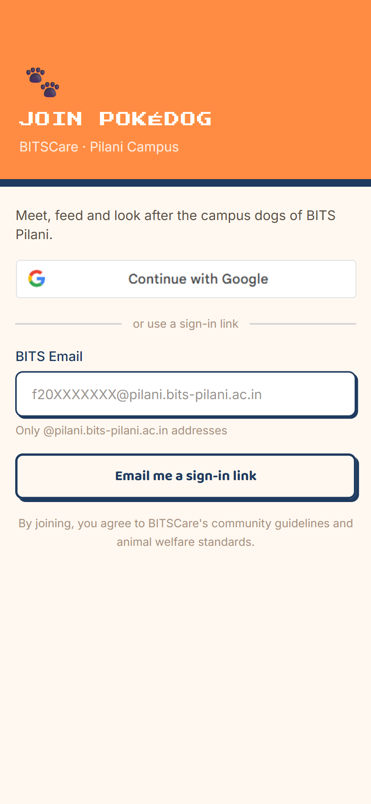
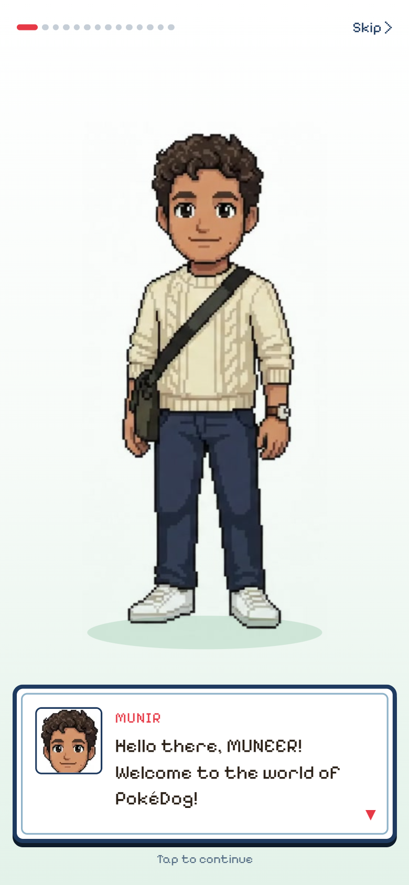
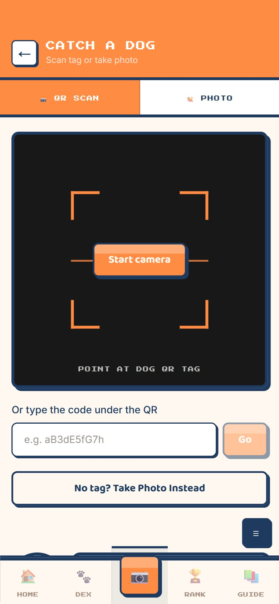
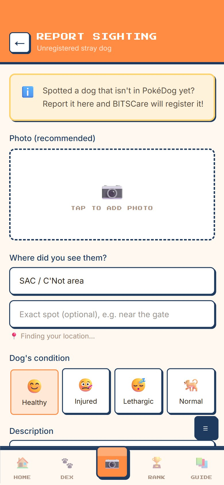
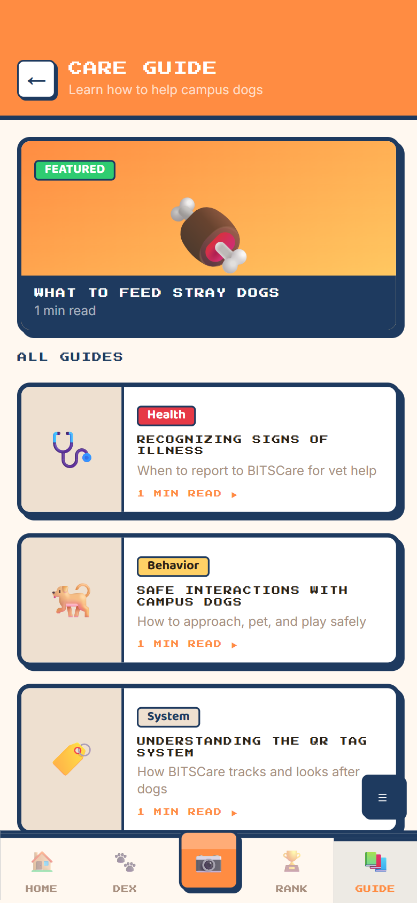
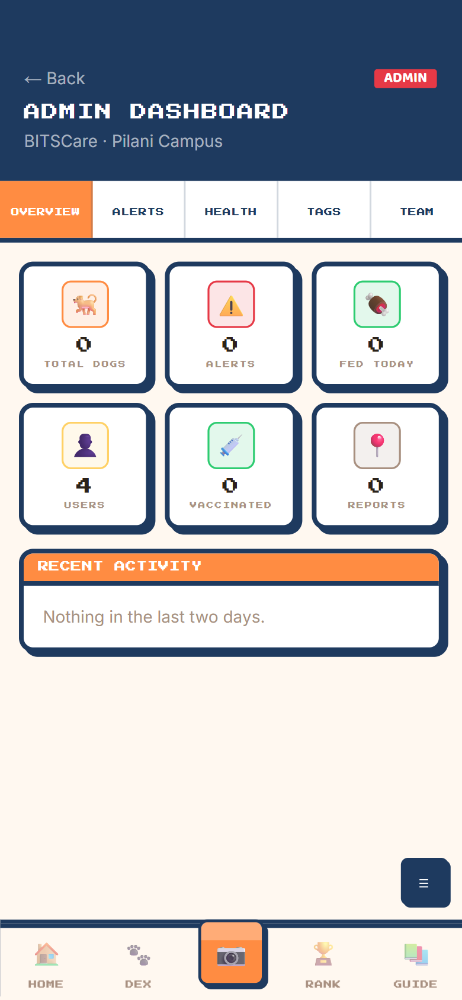
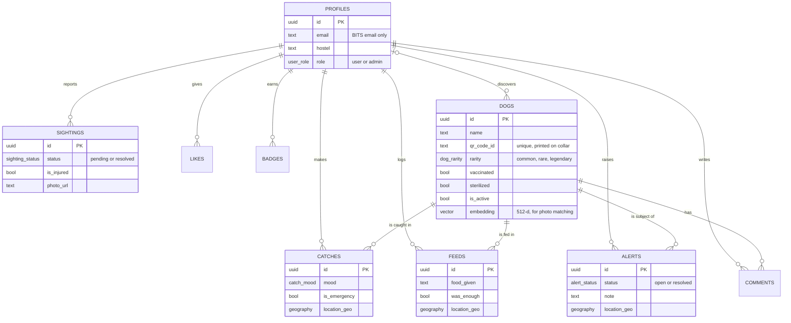

# 🐾 PokéDog

**Meet, feed and look after the campus dogs of BITS Pilani, Pokémon-style.**

**▶ Live app: [poke-dog.vercel.app](https://poke-dog.vercel.app)** (sign-in is limited to BITS Pilani accounts)

> This is the public showcase for PokéDog. The source code is kept in a private repository for security; a code walkthrough is available on request.

Every campus dog wears a collar with a QR tag. Students scan the tag to "catch" the dog, then log how it's doing: mood, feeding and location. Every catch, feed and report earns XP, so hostels compete on a leaderboard. BITSCare, the campus animal-care team, gets one shared, live record of every dog: who has been fed, where each dog was last seen, which dogs are vaccinated and sterilized, and which ones need help right now.

## Screenshots

| Sign in | Welcome intro | Catch a dog |
|:---:|:---:|:---:|
|  |  |  |
| **Report a sighting** | **Care guide** | **Admin dashboard** |
|  |  |  |

---

## The problem

Campus dogs are cared for by many students, but nothing is written down anywhere:

- Nobody knows whether a dog has already been fed today, so some are overfed and others missed.
- Injured or sick dogs are reported in scattered WhatsApp messages and are easy to miss.
- Vaccination and sterilization records live in someone's notebook.
- Caring for the dogs depends on a few dedicated volunteers.

## What PokéDog does

| For students | For BITSCare admins |
|---|---|
| **Catch:** scan a dog's QR collar tag with the phone camera | Create blank QR tags and activate them once they're on a dog |
| Log the dog's mood, with GPS location, in a few taps | Record vaccination and sterilization dates |
| **Feed:** log food given and whether it was enough | See every dog's last-seen place and feeding history |
| **Emergency:** one-tap welfare alert for an injured or sick dog | Resolve welfare alerts and untagged-dog reports |
| **Report** an untagged dog with a photo and its condition | Replace or remove photos, and lock dog names |
| **Dex:** collect dogs (common, rare, legendary) and name the ones you discover | Manage the team: make or remove admins |
| **Rank:** XP, levels, and hostel vs hostel leaderboards | |
| **Guide:** short articles on feeding, health and safe interaction | |

## Tech stack

| Layer | Technology |
|---|---|
| Frontend | Next.js 16 (App Router, Server Actions), React 19, TypeScript, Tailwind CSS v4 |
| Backend | Supabase: PostgreSQL 17, Auth, Storage, auto-generated REST API |
| Geo | PostGIS `geography(Point, 4326)` for catch, feed and alert locations |
| AI-ready | pgvector: a 512-dimension embedding column for future photo-based dog recognition |
| Auth | Google sign-in and email magic link, restricted to BITS Pilani accounts |
| Hosting | Vercel |

## Architecture

```
 Phone browser                     Vercel                              Supabase
┌──────────────┐  HTTPS   ┌──────────────────────────┐  supabase-js   ┌──────────────────────────────┐
│ Scan QR tag  │ ───────► │ Next.js 16 (App Router)  │ ─────────────► │ Auth: BITS accounts only     │
│ GPS, camera  │          │  Server Components       │   (server-side │ Postgres 17 + PostGIS        │
│ Photo shrunk │          │  Server Actions (writes) │    session     │  └─ Row Level Security on    │
│ in browser   │          │  Session-refresh proxy   │    cookies)    │     every table + triggers   │
└──────────────┘          └──────────────────────────┘                │ Storage: private photo bucket│
                                                                      └──────────────────────────────┘
```

- **All business rules live in the database** (Row Level Security, triggers and views), so they hold even if someone calls the API directly.
- **Supabase keys stay on the server.** The browser never sees them; every read and write goes through Server Components and Server Actions.
- **Each QR tag opens its own dog page.** Logged-out visitors are sent to sign in, then returned to the dog they scanned.
- **Photos are resized to JPEG in the browser** before upload, keeping uploads small on mobile data.

## Data model



Plus `badges`, `likes`, `comments`, `tips` and `care_guide_sections`, 11 tables in total. SQL views power the game screens: XP and levels per student, hostel leaderboards, most-caught dogs, each dog's last-seen location, and the top feeder of each week.

**XP:** 100 per new dog discovered · 10 per repeat catch · 20 per feed · 30 per report.
**Level** = ⌊√(XP / 100)⌋ + 1, so each level needs progressively more XP.

## Security

- **Campus-only:** sign-up is rejected for any email outside BITS Pilani, and logged-out visitors can read nothing.
- **Row Level Security on every table:** students read shared data but only write their own catches, feeds, comments and likes.
- **Column-level rules** enforced by database triggers:
  - Only admins can change vaccination, sterilization, activation or rarity.
  - Students can add a dog's first photo; only admins can replace or remove it.
  - The first student to catch an unclaimed dog can claim and name it, once, unless an admin has locked the name.
  - Users can't change their own role or email.
- **Moderation and spam limits:** reports start as pending; welfare alerts are resolved by admins, with one open alert per student per dog.
- **Private photo storage:** each user can upload only into their own folder.

## Roadmap

- [x] QR catch, feed, emergency and report flows
- [x] XP, levels, rarity, hostel leaderboards, weekly feeding heroes
- [x] Admin console: tags, health records, alerts, team
- [x] Live on Vercel
- [ ] Roll out QR collars to campus dogs with BITSCare
- [ ] Campus map of last-seen locations
- [ ] Photo-based dog recognition using the `embedding` column

## Author

**Muneer Ahmad** · BITS Pilani · built for BITSCare, the campus animal-care community.
Contact: f20251550@pilani.bits-pilani.ac.in

© 2026 Muneer Ahmad. All rights reserved.
